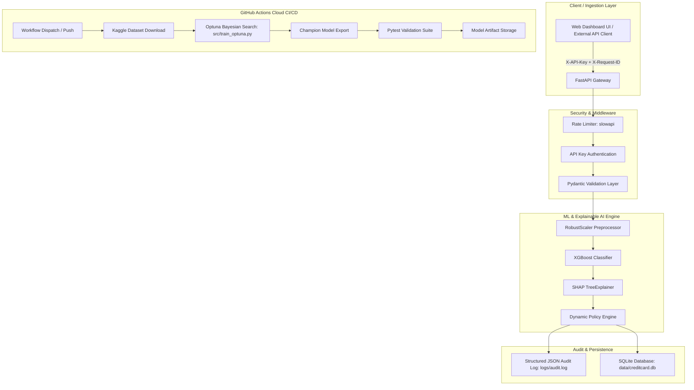

# SentinelRisk: Enterprise Fraud Detection & Explainable AI Console

[](https://github.com/saiprudhvibojja-svg/sentinel-risk-fraud-detection/actions)
[](https://sentinel-risk-fraud-detection.onrender.com)


> 🌐 **Live Web Application:** [https://sentinel-risk-fraud-detection.onrender.com](https://sentinel-risk-fraud-detection.onrender.com)

**SentinelRisk** is a hardened, production-grade credit card fraud detection system designed for real-time transactional risk assessment, sub-second latency, and explainable decision intelligence. Combining **Bayesian-optimized XGBoost**, **SMOTE rebalancing**, **SHAP TreeExplainer** feature attributions, and **dynamic policy controls**, SentinelRisk safeguards financial flows with enterprise security, rate limiting, and structured audit logs.

---

## 🕹️ Live Console Quick-Start Guide

Experience the end-to-end decision intelligence platform directly in your browser without local installation via the [Live Render Demo](https://sentinel-risk-fraud-detection.onrender.com):

### 1. Tab 1 — Real-Time Inference & SHAP (Transaction Simulator)
- **Test Quick Presets:** Switch between pre-configured transaction archetypes to observe real-time inference:
  - **Legitimate Retail:** Everyday store purchase (\$42.75) with benign behavioral vectors yielding low baseline fraud probability (~0.0%).
  - **Card-Testing:** Rapid micro-authorization (\$1.00) exhibiting typical automated validation attack characteristics.
  - **High-Risk Fraud:** Anomaly vector derived from confirmed test fraud attacks exhibiting extreme risk probability (> 99.0%).
- **Evaluate Dynamic Risk Policies:** Toggle policies (`STRICT: 0.9668`, `BALANCED: 0.8500`, `AGGRESSIVE: 0.7000`, or `CUSTOM`) to see the instant impact on authorization verdicts (`APPROVED` vs `FLAGGED AS FRAUD`).
- **Interpret SHAP Waterfall Attributions:**
  - 🔴 **Red Bars:** Features pushing risk **higher** toward fraudulent classification.
  - 🟢 **Green Bars:** Features acting as **mitigating factors** defending the transaction.
  - Inspect baseline expected value $E[f(X)]$, transaction prediction $f(x)$, and top feature-level contributions for regulatory compliance (FCRA, GDPR).

### 2. Tab 2 — Batch CSV Auditor & PSI Drift Scoring
- **Load Sample or Upload Batches:**
  - Click **"Load Sample CSV Batch"** to instantly stream 30+ randomized transactions from the database, or download the pre-formatted CSV template to upload custom transaction feeds.
- **Audit Transactions with Explainability:** Inspect batch results with risk probability meters, decision tags, and latency statistics in a paginated, searchable table.
- **Population Stability Index (PSI) Drift Scoring:**
  - Automatically assesses incoming transaction distributions against reference training data across key fraud drivers (`V4`, `V10`, `V12`, `V14`, `V17`, `Amount`).
  - View real-time drift telemetry badges: 🟢 **Stable** ($PSI < 0.10$), 🟡 **Moderate Warning** ($0.10 \le PSI < 0.25$), or 🔴 **Severe Drift** ($PSI \ge 0.25$).
- **Inspect & Export:** Click any row to examine individual SHAP feature drivers, or click **"Export Audited CSV"** to download the batch with appended risk scores and top risk drivers.

### 3. Tab 3 — Model Analytics & Retraining Studio
- **Inspect 2x2 Confusion Matrix:** Review full test-set diagnostic performance across 56,864 transactions:
  - **True Negatives:** 56,857 benign transactions correctly cleared.
  - **False Positives:** 7 benign transactions flagged (ultra-low 0.012% false alarm rate).
  - **False Negatives:** 22 missed fraud occurrences.
  - **True Positives:** 76 fraud attacks successfully intercepted (77.55% recall).
- **Precision-Recall (PR) Curve Analysis:** Examine the interactive PR curve visualizing trade-offs across cutoffs, with clear markers for the F1-optimal threshold (0.9668).
- **Monitor Population Stability:** View system-wide drift indicators and retrain recommendation alerts.
- **Asynchronous Cloud/Local Retraining:** Trigger background Bayesian Optuna hyperparameter optimization directly from the console with live status polling and telemetry.

---

## 🏛️ System Architecture



---

## 📊 System Telemetry & Model Benchmarks

Trained and evaluated on the **284,807 transaction Credit Card Fraud Dataset** (0.172% fraud incidence rate), SentinelRisk maximizes the **Precision-Recall Area Under Curve (PR-AUC)** rather than misleading accuracy metrics.

| Telemetry Metric | Measured Benchmark | Description |
| :--- | :--- | :--- |
| **PR-AUC (Precision-Recall)** | **0.8480** | Core optimization objective under heavy imbalance |
| **ROC-AUC** | **0.9769** | Diagnostic discrimination capability |
| **Optimal Decision Threshold** | **0.9668** | F1-maximizing cutoff for production deployment |
| **Precision** | **91.57%** | True fraud capture accuracy among flagged items |
| **Recall (Sensitivity)** | **77.55%** | Percentage of all fraudulent attacks intercepted |
| **False Positive Rate** | **0.012%** | Only 7 false alarms across 56,864 test transactions |
| **P95 Inference Latency** | **< 35 ms** | End-to-end model inference + SHAP Tree attribution |

---

## 🛡️ Security, Rate Limiting & Audit Trail

### 1. API Key Authentication
All write, batch, and prediction endpoints require the `X-API-Key` header:
- Header: `X-API-Key: sentinel-dev-secret-key-2026` (configurable via `SENTINEL_API_KEY` environment variable).
- Unauthenticated requests receive `HTTP 401 Unauthorized`.

### 2. Rate Limiting (`slowapi`)
- `POST /predict`: **60 requests/minute**
- `POST /predict-batch`: **10 requests/minute**
- `POST /predict-batch-csv`: **10 requests/minute**

### 3. Traceability (`X-Request-ID`)
Every request receives a unique UUIDv4 `X-Request-ID` attached to response headers and propagated to structured audit logs.

### 4. Structured Audit Log (`logs/audit.log`)
Audit events are appended atomically in JSON Lines format:
```json
{
  "timestamp_utc": "2026-10-28T09:48:12.104230+00:00",
  "request_id": "3f88e14e-6e84-4861-8ff8-e6d2bc629471",
  "client_ip": "127.0.0.1",
  "endpoint": "/predict",
  "amount": 406.0,
  "fraud_probability": 0.985412,
  "decision_threshold": 0.9668,
  "verdict": "FLAGGED_AS_FRAUD",
  "latency_ms": 22.45
}
```

---

## 🧠 Explainable AI (SHAP) & Dynamic Policy Controls

### SHAP Feature Attributions
Every transaction evaluated returns **Top 5 Risk Drivers** derived via `shap.TreeExplainer`:
- **Directional Impact:** Identifies whether a feature increases risk (`RISK_FACTOR`) or mitigates risk (`MITIGATING`).
- **Auditability:** Compliance with regulatory explainability requirements (FCRA, GDPR).

### Dynamic Risk Policies
Organizations can dynamically update risk tolerance without restarting application instances:
- **STRICT** (`threshold = 0.9668`): Minimizes customer friction, 0.012% false alarms.
- **BALANCED** (`threshold = 0.8500`): Balanced posture for medium-risk windows.
- **AGGRESSIVE** (`threshold = 0.7000`): Maximum fraud capture during elevated threat scenarios.
- **CUSTOM** (`threshold = 0.01 - 0.99`): User-defined boundary.

---

## 📡 API Endpoint Reference

| Method | Endpoint | Access | Rate Limit | Description |
| :--- | :--- | :--- | :--- | :--- |
| `GET` | `/` | Public | None | Single-Page Reactive Audit Console |
| `GET` | `/health` | Public | None | API, Model & Explainer Health Check |
| `GET` | `/policy` | Public | None | Current Active Risk Policy & Thresholds |
| `PATCH`| `/policy` | **Protected** | None | Update Risk Mode (`STRICT`, `BALANCED`, `AGGRESSIVE`, `CUSTOM`) |
| `POST` | `/predict` | **Protected** | 60/min | Single Transaction Inference + SHAP Drivers |
| `POST` | `/predict-batch` | **Protected** | 10/min | Batch JSON Inference + SHAP Explanations |
| `POST` | `/predict-batch-csv` | **Protected** | 10/min | Multipart CSV Batch Inference + Summary |
| `GET` | `/api/sample-csv` | Public | None | Generate randomized synthetic CSV batch from DB |
| `GET` | `/api/sample-json` | Public | None | Sample randomized JSON transactions from DB |
| `GET` | `/api/model-analytics` | Public | None | Telemetry benchmarks, confusion matrix & PR curve points |
| `POST` | `/api/retrain` | Optional | None | Trigger Optuna Bayesian hyperparameter search in background |
| `GET` | `/api/retrain/status` | Public | None | Check real-time retraining progress and status |
| `GET` | `/api/drift/status` | Public | None | Real-time decile PSI drift metrics, KS stats & retrain recommendation flag |

---

## 📈 Enterprise MLOps: Population Stability Index (PSI) Drift Detection

In real-world financial fraud environments, cardholder purchasing patterns and fraud attack vectors continuously shift. SentinelRisk features an enterprise data drift detection engine that computes the **Population Stability Index (PSI)** and **Kolmogorov-Smirnov (KS)** divergence across key fraud drivers (`V4`, `V10`, `V12`, `V14`, `V17`, `Amount`) against the reference training population.

### Decile Binning & Mathematical Formulation
For each monitored feature, the training distribution is partitioned into 10 decile bins ($k = 10$). For any incoming transaction batch ($\ge 15$ transactions), empirical frequencies are binned into identical decile edges:

$$PSI = \sum_{i=1}^{k} \left(Actual\%_i - Expected\%_i\right) \times \ln\left(\frac{Actual\%_i}{Expected\%_i}\right)$$

### Decision Thresholds & Interpretation
| PSI Value | Drift Severity | System Interpretation & Recommended Action |
| :--- | :--- | :--- |
| **$PSI < 0.10$** | **Negligible Drift** (🟢 Stable) | Population distribution aligns with baseline; model inferences are optimal. |
| **$0.10 \le PSI < 0.25$** | **Moderate Drift** (🟡 Warning) | Moderate distribution divergence; monitor incoming batch streams closely. |
| **$PSI \ge 0.25$** | **Significant Drift** (🔴 Severe) | Severe population shift detected; automated alert triggers model retraining recommendation. |

Batch audit responses automatically attach `drift_assessment` objects, and the web console provides real-time drift telemetry badges, per-feature breakdown modals, and automated retraining callouts.


---

## 🐳 Running with Docker (Production Containerization)

SentinelRisk includes a hardened, multi-stage `Dockerfile` and `docker-compose.yml` configured with non-root security (`appuser`), persistent audit log volumes, live model hot-reloading, and automated healthchecks.

### Quick Start with Docker Compose
```bash
# Build and launch in detached mode
docker compose up --build -d

# Verify container health and logs
docker compose ps
docker compose logs -f

# Stop container
docker compose down
```
Access the interactive console at [http://localhost:8000](http://localhost:8000).

---

## 🚀 Quickstart & Local Setup

### 1. Prerequisites
- Python 3.11+
- Virtual environment tool (`venv` or `uv`)

### 2. Installation
```bash
# Clone the repository
git clone https://github.com/saiprudhvibojja-svg/sentinel-risk-fraud-detection.git
cd sentinel-risk-fraud-detection

# Setup virtual environment
python -m venv .venv
source .venv/bin/activate  # On Windows: .\.venv\Scripts\activate

# Install dependencies
pip install -r requirements.txt
```

### 3. Database Ingestion & Training
```bash
# Ingest raw Kaggle CSV into SQLite creditcard.db
python src/db.py

# Run Bayesian Optuna training pipeline (20 trials)
python src/train_optuna.py --n-trials 20 --timeout 600
```

### 4. Run API & Interactive Web Console
```bash
uvicorn src.api:app --reload --host 0.0.0.0 --port 8000
```
Open [http://localhost:8000](http://localhost:8000) in your browser.

### 5. Execute Test Suite
```bash
pytest -v tests/
```

---

## ☁️ Cloud CI/CD Pipeline (GitHub Actions)

The workflow `.github/workflows/train_model.yml` automates cloud model retraining and evaluation:
1. Triggers on `push` to `main` (for `src/train*.py` changes) or manual `workflow_dispatch`.
2. Downloads the official Kaggle dataset using repository secrets (`KAGGLE_USERNAME`, `KAGGLE_KEY`).
3. Ingests data into SQLite and executes the 20-trial Optuna Bayesian search on `ubuntu-latest`.
4. Runs full integration tests via `pytest`.
5. Uploads the champion model bundle (`models/fraud_model.joblib`, `reports/metrics.json`, `reports/pr_curve.png`) as a pipeline artifact.

---

## 📜 License
This project is licensed under the MIT License.
